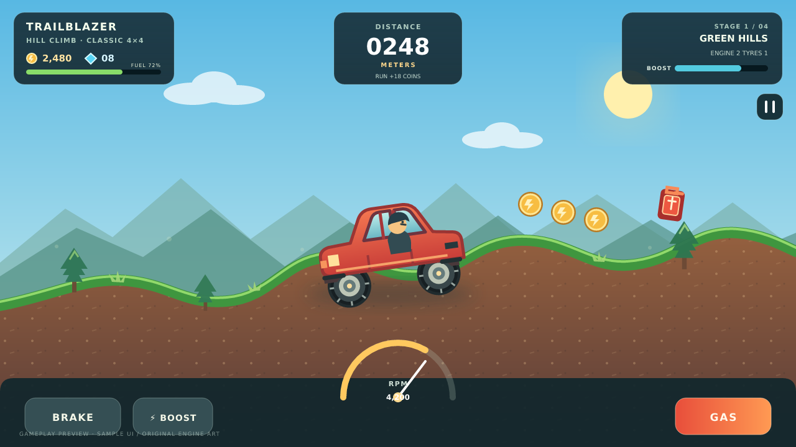

# 2D WORLD Engine

A **native Android** 2D game editor and runtime. The editor is built with Android Views and Canvas in Java — **not a website, PWA, or WebView wrapper**. It works offline and stores human-readable project JSON locally.

## Build the Android editor APK

Open this repository in Android Studio (JDK 17, Android SDK Platform 35 and Build Tools 35) and choose **Build → Build APK(s)**, or run:

```sh
./gradlew :app:assembleDebug
```

The debug APK is written to `app/build/outputs/apk/debug/app-debug.apk`. The Gradle wrapper and Android sources are included. The first build downloads the Android Gradle plugin and SDK components; the editor itself does not require internet after installation. A GitHub Actions workflow also assembles the debug APK and uploads it as an artifact on this session branch.

## What works today

- Native project dashboard, creation wizard, multiple scenes, sample templates and **six editable playable example projects**, including the full **Trailblazer: Hill Climb** starter game.
- Touch scene editor: select, move, rotate, scale, grid/snap, pinch zoom, two-finger pan, scene tabs, hierarchy, reparenting, duplication, visibility/lock, inspector, undo/redo.
- **623 bundled resources** with real thumbnails/previews: procedural CC0 vector sprites/textures rendered to PNG, 231 Kenney Pixel Platformer CC0 PNG sprites and tiles, and 30 original synthesized WAV effects. Includes 1178 authored independent parts for modular characters, vehicles and buildings. Asset metadata and license information are shown in the browser.
- Import raster images/audio through Android's system file picker; grid-slice sprite sheets into actual PNG frame assets and an animation; paint tilemaps, add components, edit colliders and physics settings, prefabs, particles, lights, audio, animation keyframes and safe declarative scripts.
- Play/pause/restart, full-screen preview, touch and keyboard controls, AABB/circle collision and sensors, gravity, basic controllers and AI, collectible interactions, multi-scene transitions, particles, generated SFX, on-screen collision debugging, FPS/object/particle counters.
- **Hill Climb game template:** seeded, endless smooth-noise hills; spring-suspension 4×4 with independent rotating wheels; gas/brake/boost; driver-head crash detection; fuel, coin and diamond pickups; speed-follow camera; four biomes; persistent garage with four vehicles and engine, suspension, tyre, fuel-tank and 4WD upgrades.
- Stable-ID references, local project backups, 30-second autosave, recovery drafts, import/export `.2dw` project ZIPs, and an **Android Studio game project export** containing the actual authored data, assets and native game runtime.

## Hill Climb template and Android APKs

In the editor choose **New project → Hill Climb**, or play/open **Trailblazer: Hill Climb** from the example cards. Hold **GAS** to accelerate, **BRAKE** to slow/reverse and pitch in the air, and **BOOST** to spend the regenerating boost meter. Collect coins, rare diamonds and red fuel cans; crashing the separate driver-head hitbox or emptying the tank ends the run. Pause to enter the garage, unlock the trail bike, monster truck and moon rover, trade diamonds for coins, and buy engine, suspension, tyre, fuel-tank and 4WD upgrades. The generated countryside continues into desert, arctic and low-gravity moon biomes.



*Original vector preview of the template. The GitHub Actions run also attaches real emulator gameplay screenshots.*

The **GitHub Actions** workflow runs on pushes to `arena/**` and pull requests. It builds the native editor APK, opens the Hill Climb template on an Android emulator, exports and compiles the game's standalone debug APK, installs it for a gameplay smoke test, and uploads the APK, editable Gradle export, screenshots and device evidence as run artifacts. Download **Trailblazer-Hill-Climb-Android-debug-APK** from the workflow run's **Artifacts** section. The APK is debug-signed for testing, not Play Store distribution.

## On-device APK building: current limit

The **editor itself** builds to a real Android APK with the toolchain above. Exported **games** are compilable Android Gradle projects; use Android Studio or `./gradlew :app:assembleDebug` in the exported folder to produce a game APK. Building an arbitrary user's game APK wholly inside this Android app is **not** offered: it would require shipping and executing an Android SDK, Gradle, D8, AAPT2 and signing tools on the device. The Build panel explains this explicitly; no fake build or installation progress is shown. Release signing must be configured by the developer.

This is a working native engine foundation, **not** all the advanced features in the master specification. Not yet implemented: polygon/compound physics and joints, shader graphs, arbitrary semantic decomposition of imported flat images, dockable panel rearrangement, advanced visual node wiring, and a complete on-device APK toolchain. The built-in block-to-script authoring tool is a small safe subset, not a full graph editor. See the in-app guides for supported syntax and workflows.

## Project format and asset licenses

Projects live under Android internal storage `files/projects/<project-id>/project.json` with imported files under `assets/`. `.2dw` backups are ZIPs containing `project.json` and imported assets. Scenes reference immutable IDs, not filenames; renaming an asset does not break a scene. Imported scripts are interpreted by a bounded declarative DSL, never `eval`'d or run as arbitrary commands. Project ZIP import validates paths and size limits.

Bundled artwork from Kenney's *Pixel Platformer* is **CC0** — the repository includes the original archive and license. Procedural vectors and synthesized effects are original CC0 resources. User-imported assets retain their own licenses. Sources for the procedural asset generator live under `tools/asset-source/`; regenerate PNGs/presets/SFX with `npm ci && npm run assets` (Python 3 and Node 22).

## Native module layout

```
app/src/main/java/com/world2d/engine/
  assets/       Resource catalog, lazy bitmap cache, audio preview
  data/         Project format, atomic persistence, import/export, examples
  editor/       Native dashboard, panels, touch viewport and Android UI
  runtime/      Physics, input, script interpreter, Hill Climb mode, particles, game loop
  export/       Native game Activity and Android Gradle source exporter
```
